# Reason Commons

**Find the next useful move, with reasoning you can inspect and revise.**

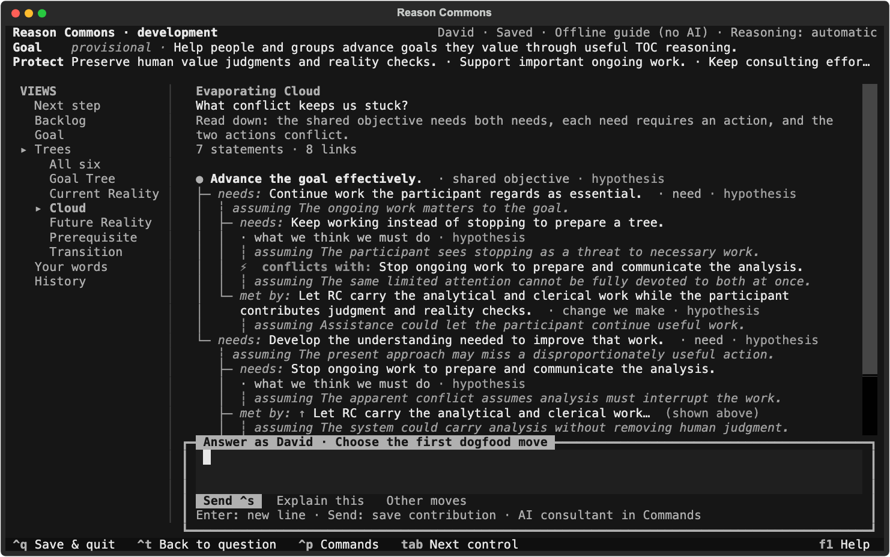

Reason Commons helps you reason about change: what you are
aiming for, what is really in the way, which conflict keeps you stuck and what to
try next. It lays that reasoning out as the six connected trees of the **Logical
Thinking Process** (from the Theory of Constraints), can support a next action
with a small test: you write down what you expect **before** you act, and compare
it with what happened. Every statement keeps who said it and how it was worded,
and everything lives in a plain folder you own. You can use it as a full-screen
terminal workspace, or in chat through a skill in your coding agent.

It suits any change where you are not sure what will work. A movement might want
to turn people who resonate with its ideas into people who practise them. A
community group might want more neighbours at the monthly meeting without burning
out the organisers.

## Two ways to use it

You can work in the **workspace**, a full-screen terminal app built for this
reasoning, or ask a **coding agent** (Claude Code or Codex) through the Reason
Commons skill. Both use the same goal folders in `~/ReasonCommons` and the same
rules: your words are kept as you wrote them, and what a consultant proposes waits
for your decision. You can switch between them on the same goal.

| | The workspace | The skill, in a coding agent |
| --- | --- | --- |
| What you need | macOS or Linux, a terminal and [uv](https://docs.astral.sh/uv/) | macOS or Linux, [Claude Code](https://claude.com/claude-code) with a Claude subscription, and uv; Codex works too, set up by hand |
| How you use it | Run `reason-commons`; answer one question at a time, with keys, views and a Backlog to decide | Ask in chat: "Use the reason-commons-contribute skill. I'm Sam. Open my-goal." |
| Who drafts the questions | The built-in guide (free, fixed questions, no advice), Claude (with an API key) or a local model | The coding agent itself, with no API key |
| What it costs | Nothing with the guide or a local model; Claude is paid per reply, estimated as you go | Your subscription's allowance: every turn uses it, including just looking, and a large goal's consultation is about 40,000–50,000 tokens; nothing estimates it |
| Strengths | Built for this work: trees with colour, folding and markers for what changed; stepping through history; drafts saved as you type; a cost meter; works offline with the guide or a local model | Adaptive questions with no key or separate bill; plain-language chat in a tool you already use |
| Limits | A full-screen app with its own keys to learn; adaptive questions need an API key or a local model | Trees appear as plain text drawings; you name the skill when you ask; the app records which model the agent says it is, but cannot check it; how well a coding agent consults has not been evaluated yet; the same agent drafts proposals and presents them to you; very large views may arrive as a file the agent reads |

**Which to choose.** Start with the workspace if you want to see and move around
the trees and their history, work offline, or do not use a coding agent. Start
with the skill if you already use Claude Code and want adaptive questions without
an API key. Either way, the other can pick up the same goal later.

## Quick start: the workspace

On macOS or Linux, install [uv](https://docs.astral.sh/uv/) once, then open a new
terminal window:

```sh
curl -LsSf https://astral.sh/uv/install.sh | sh
```

Install Reason Commons and start it:

```sh
uv tool install git+https://github.com/life-itself/reason-commons-tui
reason-commons
```

There is no Python setup to manage. To update later, run `uv tool upgrade reason-commons`.

The first time, choose **Continue Reason Commons** to import the prior RC work into
an editable commons, or **Start my first goal** for your own work. The RC commons retains
the supplied conversation and its attribution, substantial trees, and ten readable
stages explaining why manual RC led to the implemented interface. History records
its adoption, so an empty Backlog accompanies reasoning that is in the model.
The pre-history is explicitly reconstructed from your prompt; historical dates,
engineering logs and measurements are not invented.

Tours, consultant setup and the Second Renaissance editorial example are under
**F1 Help**. **F2 Settings** changes your preferences and, inside a commons, how reasoning is accepted.

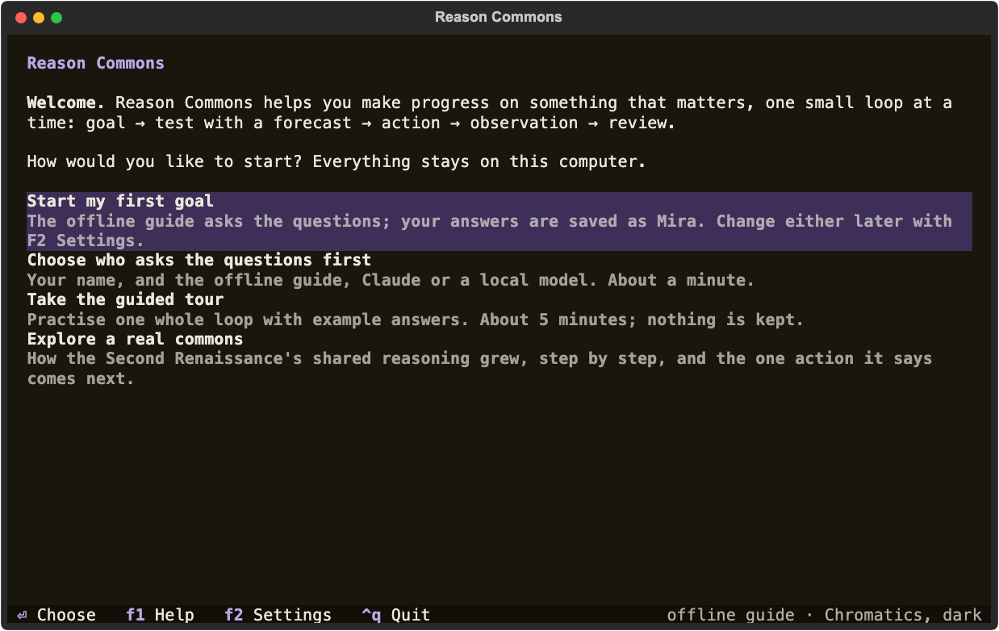

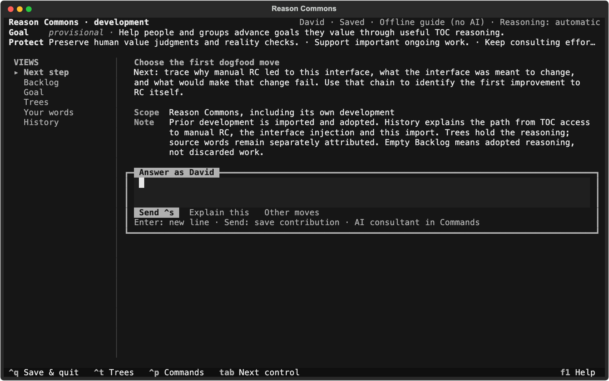

After that, `reason-commons` opens a list of your goals. A goal opens on one
question; you answer in ordinary words. Enter adds a line, **Ctrl+S** sends,
**Ctrl+P** lists every command and **Ctrl+Q** quits. Everything is saved as you
type, including an unsent draft, and you come back to where you were.

## Quick start: the skill in Claude Code

With [uv](https://docs.astral.sh/uv/) installed (see above), add the Reason Commons
plugin. It brings the skill and its server, with Claude Code as the consultant:

```sh
claude plugin marketplace add life-itself/reason-commons-tui
claude plugin install reason-commons@reason-commons --scope user
```

Start a new Claude Code session and ask:

> Use the reason-commons-contribute skill. I'm Sam. Create a goal called my-goal.

Answer its questions in chat. Ask "What is waiting for me?", "Accept the goal",
"Show the trees" or "Import the trees from FILE". The first start downloads and
builds Reason Commons, which takes about 20 seconds; if the skill reports its tools
missing, run `/mcp` to reconnect. Goals go to `~/ReasonCommons`, so the same goal
opens in the workspace with `reason-commons` whenever you want it. The plugin
follows this repository's main branch. Codex setup, the manual install, and what
the skill leaves to the workspace are in [use Reason Commons from an AI agent](docs/skill-use.md).

## How it works

A **commons** keeps a goal, contributions, sources, reasoning, decisions and
history across conversations. Its **model** is the accepted reasoning currently
used to guide the work. Recording a proposal preserves it in the commons;
acceptance admits it to the model, either explicitly or under your automatic
acceptance setting. Earlier wording and rejected or undone reasoning remain in
History.

### Six questions, six trees

The six trees organize different questions when that detail helps the work.
They grow as needed and can remain partial.

| Question | Tree |
| --- | --- |
| What must be true for us to reach the goal? | [Goal Tree](docs/the-trees.md#goal-tree-what-must-be-true) |
| Why are we not there yet? | [Current Reality Tree](docs/the-trees.md#current-reality-tree-why-are-we-not-there) |
| What conflict keeps us stuck? | [Evaporating Cloud](docs/the-trees.md#evaporating-cloud-what-keeps-us-stuck) |
| If we change this, will it work, and what could go wrong? | [Future Reality Tree](docs/the-trees.md#future-reality-tree-will-it-work) |
| What stands in the way, and what comes first? | [Prerequisite Tree](docs/the-trees.md#prerequisite-tree-what-comes-first) |
| What exactly do we do next? | [Transition Tree](docs/the-trees.md#transition-tree-what-exactly-do-we-do) |

The trees grow from the conversation. With Claude or a local model as consultant,
tell it what causes a problem, which conflict keeps you stuck, what stands in the
way or what you plan to do. It proposes each statement for its tree, in your words,
linked to the others, and you decide what goes in (see below). Ask it to reword or
drop something and it proposes that too; the earlier wording stays in the history.
Every arrow shows the assumption it rests on, so you can see where to push back.

Press **Ctrl+T** to open the trees. The first time, they open on **All six**: every
tree folded at what it is for, so you see the whole before going into one.
**Space** unfolds a branch and **Enter** opens its tree; the six are also listed under
**Trees** on the left, and **Ctrl+N** steps through them. Each line reads as a
sentence ("because: the group lacks a cadence"), with the statement's role after it
and the assumption behind the link underneath; a chain runs down one spine, so a
Prerequisite Tree reads as a ladder. A complete Evaporating Cloud is drawn as its
five boxes, both sides at equal weight. **↑** and **↓** choose a statement and show
the question worth asking of it, what it links to and where it came from. Trees you
already have come in from an `.ltp.yaml` file and go out the same way (**Ctrl+P**,
then **Import trees** or **Export trees**); what a file brings in waits for you like
any proposal.

Here is one tree from the separate editorial example the app includes: the **Second
Renaissance**, a movement that wants to help bring about a wiser, more
regenerative culture. Its Evaporating Cloud brings out the hidden assumption
behind a conflict that kept the group stuck.


<details>
<summary><b>See the other five trees for the Second Renaissance</b></summary>

**Goal Tree.** The vast goal breaks into three critical success factors and six
necessary conditions, so any small step can be checked against the whole.


**Current Reality Tree.** Many people resonate, yet few enter sustained practice.
Following the symptoms down leads to one likely constraint: there is no reliable
path from interest to practice.


**Future Reality Tree.** Before committing, check that the changes really lead to
the goal, and what they might break. Two risks show up, and each gets a trim.


**Prerequisite Tree.** Seven obstacles, each overcome by an intermediate
objective, in order. The first is to agree how the model itself gets checked.


**Transition Tree.** Concrete actions, each with what you expect to see when it
works. The first is one time-boxed review of the whole model.


</details>

[The six trees, explained](docs/the-trees.md) shows how to read each one, using
the Second Renaissance's
[tree-by-tree analysis](https://github.com/life-itself/reasoncommons/tree/main/ltp).

### You decide what enters your model

The consultant drafts what your words could mean; you decide what becomes part of
your reasoning. After each reply, **Next step** draws what it proposes beside the words
it came from, marked *proposed*. **Accept all** admits it; **Backlog** lists everything
waiting, in the order it is best decided: a new goal first, since everything else is
judged against it, then the trees in order, and whatever a proposal needs before it.
Accepting puts a statement in your model; it does not make it true.

When you accept a change to something, whatever cites it is flagged for review, with
the change that raised the flag, so a consequence reaches one step further each time.
Every acceptance can be undone from **History**, and an undo is final. If you trust the
consultant, **F2 Settings**, **Reasoning**, **Automatic** lets later proposals in as
they arrive. **Require acceptance** keeps them in Backlog. Older waiting proposals
still need a decision. The imported RC demonstration starts in Automatic mode;
new personal commons require acceptance. Commands offers the same choices.

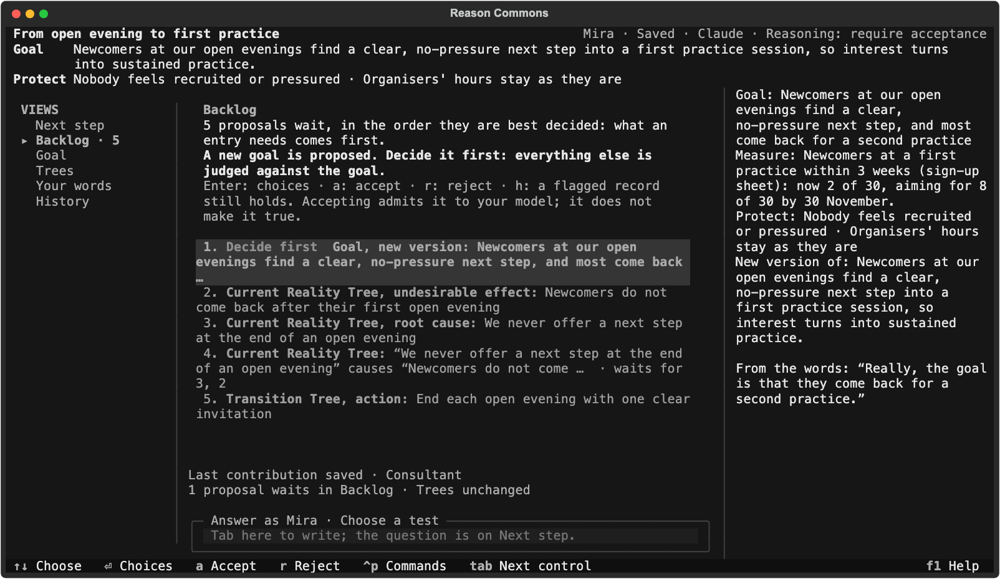

### From tree to test

Trees say what might work. The loop finds out: you take **one action**, write down
what you expect before it happens, do it, and review what happened against that
forecast.

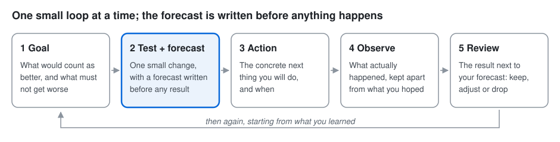

The forecast can't be quietly rewritten afterwards, so at review it sits next to
the result. That is where the learning is. A test can name the tree action it
carries out, and its forecast and result then show under that action in the Trees
view.

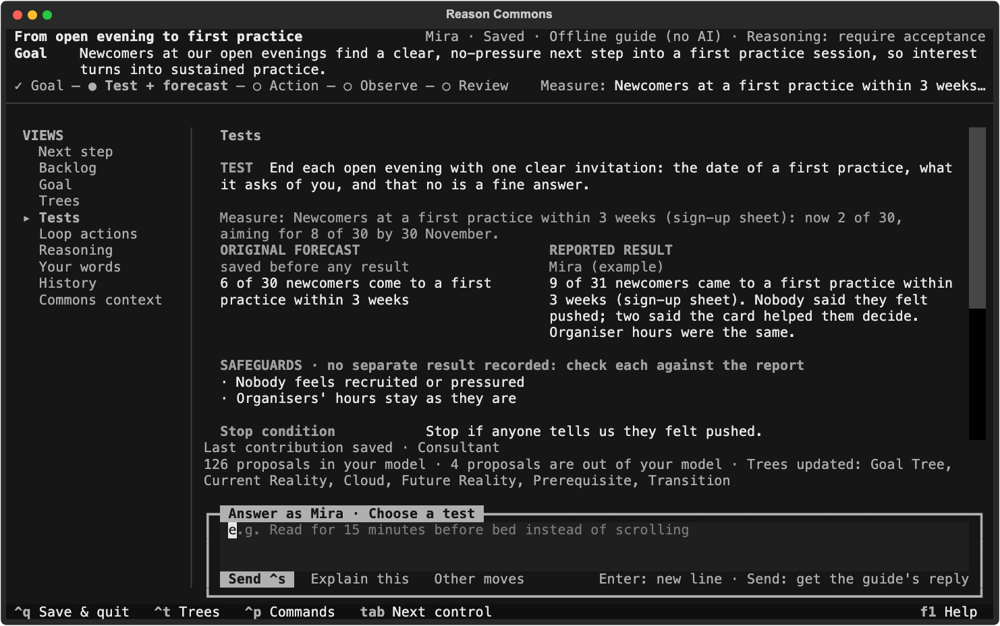

After one loop you have a written goal and safeguards, a forecast, an honest
record of what happened and a decision you can explain.

## Who asks the questions

Reading, browsing, history, export and import never need a model. In the
workspace, the questions come from one of three consultants (in a coding agent, the
agent itself can also be the consultant; see [two ways to use it](#two-ways-to-use-it)):

| | Built-in guide | Claude | Local model (LM Studio) |
| --- | --- | --- | --- |
| What it does | Asks the loop's questions in a fixed order; never gives advice | Adapts its questions, notices what is missing, gives advice on request and grows the trees | The same as Claude, on your own hardware |
| What you need | Nothing | An Anthropic API key | LM Studio with a chat model loaded |
| What it costs | Nothing | Paid per reply: about $0.004 with Claude Haiku 5.5 (the default), $0.05 with Sonnet 5.5 for one reply with deeper reasoning; the footer, each reply's notice and `reason-commons usage` estimate it, with a soft monthly budget if you want one | Nothing beyond your hardware |
| Does your goal leave your computer? | No | Yes: each consultation sends the goal's saved records to Anthropic | No |

The workspace starts with the built-in guide. Choose another under F2 **Settings**
on the home screen, then **You** (a Claude key is checked, and you pick from the models
it can use), or switch for a session with **Ctrl+P**. If a consultation fails, your words
are kept and a **Retry** button appears. `reason-commons providers` checks your
setup without sending anything.

More: [use Claude or a local model](docs/use-a-model.md) and
[choosing a consultant](docs/providers.md).

## Your reasoning is kept

- **One folder per goal.** Goals live in `~/ReasonCommons` (or `REASON_COMMONS_HOME`)
  as plain YAML. Settings and keys are kept elsewhere and never go into a goal.
- **A history you can step through.** **History** lists every saved step on one
  row: when, the question it answered or the decision taken, and what entered the
  model (and who, once more than one person has written). Open one to see the goal
  as it was then, and step with ← and →; **u** undoes a step's acceptance.
- **Move and share.** Export a goal as a portable `.reasoncase` file and import it
  elsewhere, with its whole history.

See [back up, share and move goals and trees](docs/back-up-and-share.md).

## Read a separate editorial example

**F1 Help**, **Explore an editorial example: Second Renaissance** opens a
read-only, source-based reconstruction with 24 saved steps and trees. Its
interpretations are editorial and its quotations remain a consent draft. Stepping
through it demonstrates local history inspection; it does not establish a real
trial's success or participant agreement.

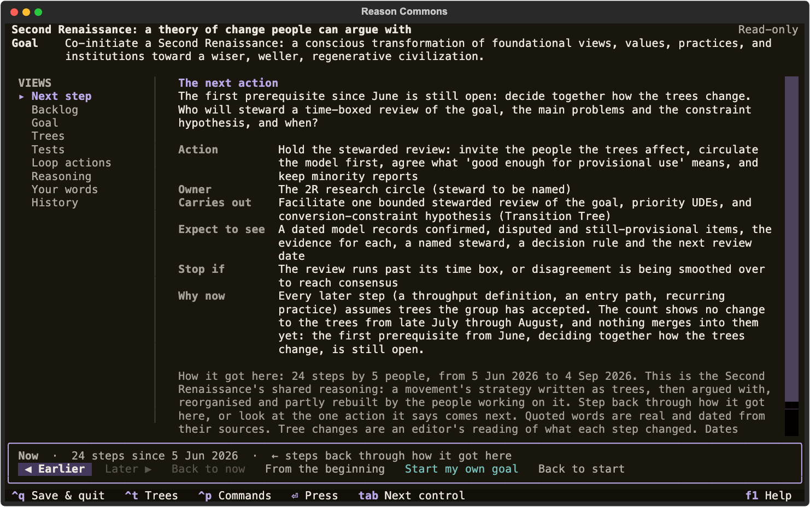

## Beyond the workspace

- **From the terminal:** `reason-commons trees FOLDER` draws a goal's trees
  (`--tree current_reality` draws one), `show` reads any view offline, and
  `export` and `import` move goals. Run `reason-commons --help` for the full list.
- **From an AI agent:** the skill and MCP server let Claude Code or Codex hold the
  same conversation with the same rules; see [the quick start](#quick-start-the-skill-in-claude-code)
  and [use Reason Commons from an AI agent](docs/skill-use.md).

## Status

The accepted simplified application is **v1**, for personal use. Its scope is
separate from live consulting quality and participant usability evidence, which
remain outstanding.

| | |
| --- | --- |
| **Works now** | The loop end to end, offline with the built-in guide or with an AI consultant; all six trees, grown in conversation by Claude or a local model, or imported; a backlog where you accept or reject what the consultant proposes, with review flags and undo; History for every goal; export and import; the editable RC development import, the separate editorial example and the guided tour |
| **Planned** | Joint causes (AND), rival explanations; review of consequences no reference records; automatic acceptance above a confidence you set; group work, with several people's positions on one tree |

The order follows the [delivery plan](reason-commons-spec/delivery-phases.md).

## Documentation

- [Tutorial: your first loop](docs/tutorial.md), step by step with pictures.
- [The six trees, explained](docs/the-trees.md) and [the loop, explained](docs/the-loop.md).
- [Workspace reference](docs/tui.md): keys, views, commands and settings.
- [All documentation](docs/README.md).
- Questions or ideas: [open an issue](https://github.com/life-itself/reason-commons-tui/issues).

## Contributing

Start with [contributing](CONTRIBUTING.md) and [how we develop](docs/development/README.md).
The [architecture](ARCHITECTURE.md) explains the domain, application and adapter
boundaries, and how BDD and replaceable skills use the same application surface.
The [v1 delivery report](docs/v1-delivery.md) records what is delivered, and the
[validation guide](docs/validation.md) runs live-model, real-agent and recovery
evaluations.

[MIT License](LICENSE)
